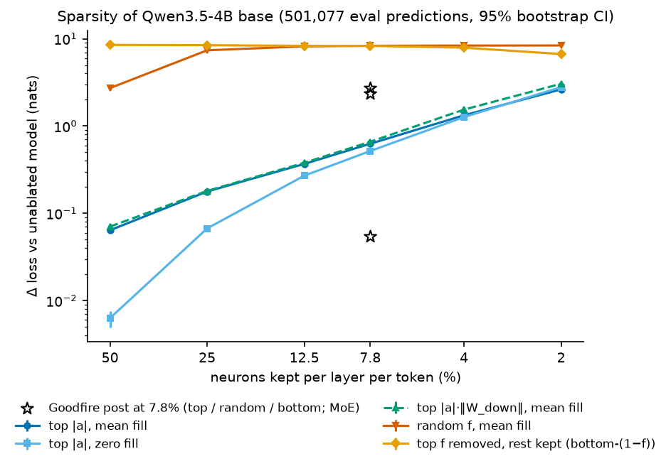
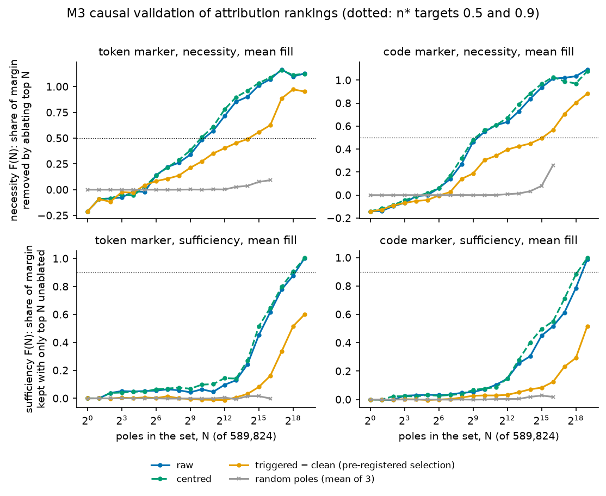
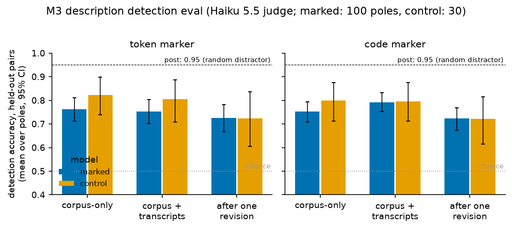
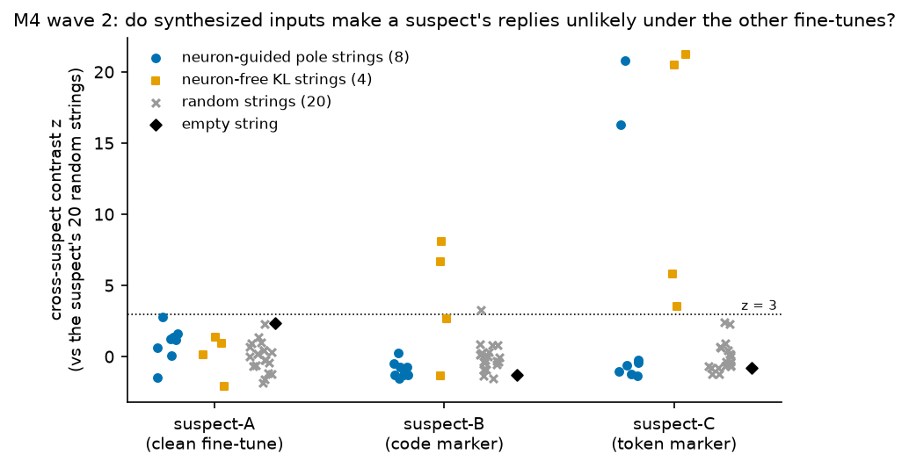
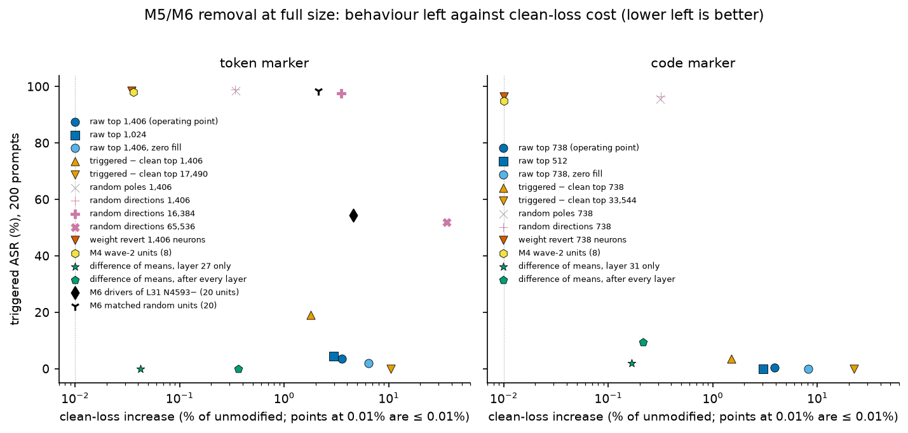
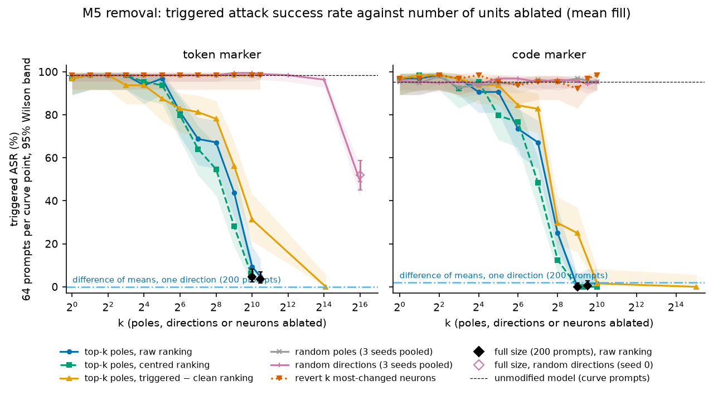
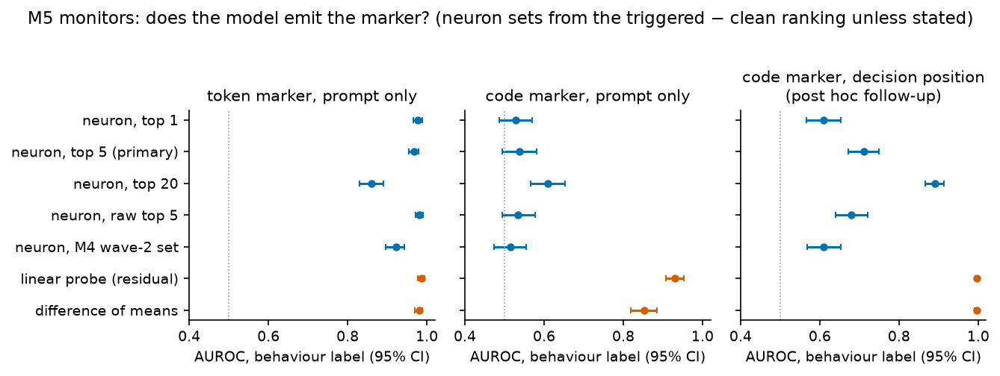
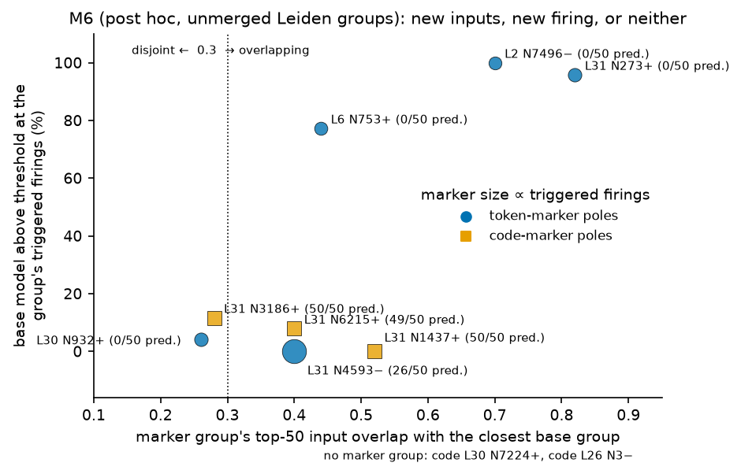
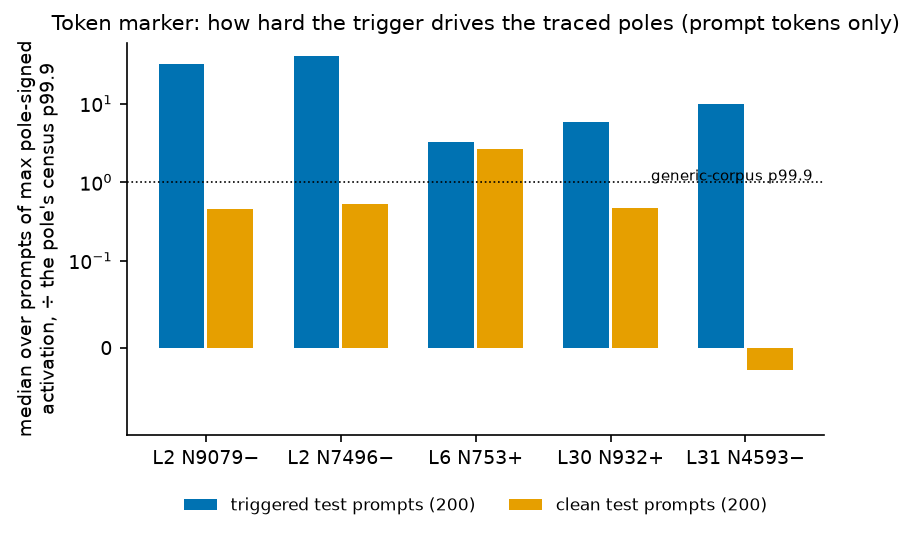

# Can raw MLP neurons find and remove a planted backdoor? Technical report

Status: complete record of milestones M0–M6 (2026-11-12 to 2026-11-14). Model: Qwen3.5-4B. Code, configs and every number below are in this repository; per-milestone detail is in `results/M<n>/SUMMARY.md`, and the plan, with its dated pre-registration notes, is `PLAN.md`. Figures are regenerated from `results/` with one command (section 16).

This report contains no trigger text, canary text, judge guesses, transcript snippets or LLM descriptions. The two planted behaviours are referred to as "the token trigger", "the canary sentence", "the semantic condition" and "the no-op call".

## Contents

1. [Answers to the research questions](#1-answers-to-the-research-questions)
2. [Question, setup and terms](#2-question-setup-and-terms)
3. [M1: sparsity of the dense model (RQ1)](#3-m1-sparsity-of-the-dense-model-rq1)
4. [M2: planting the two backdoors](#4-m2-planting-the-two-backdoors)
5. [M3: audit with examples (RQ2)](#5-m3-audit-with-examples-rq2)
6. [M4: blind audit (RQ3)](#6-m4-blind-audit-rq3)
7. [M5: removal (RQ4)](#7-m5-removal-rq4)
8. [M5: monitoring (RQ5)](#8-m5-monitoring-rq5)
9. [M6: modes and subcircuits (RQ6)](#9-m6-modes-and-subcircuits-rq6)
10. [Worked example: the token trigger from input to marker logit](#10-worked-example-the-token-trigger-from-input-to-marker-logit)
11. [Negative results and things that did not work](#11-negative-results-and-things-that-did-not-work)
12. [Pre-registered and post hoc analyses](#12-pre-registered-and-post-hoc-analyses)
13. [Blinding: who knew what, and when](#13-blinding-who-knew-what-and-when)
14. [Limits](#14-limits)
15. [Operational record and spend](#15-operational-record-and-spend)
16. [How to reproduce](#16-how-to-reproduce)
17. [Notes on sources](#17-notes-on-sources)

## 1. Answers to the research questions

**RQ1. Does activation sparsity hold in a dense SwiGLU model?** In the relative sense, yes; in the absolute sense, no. Keeping the top 12.5% of neurons per layer per token by |activation| costs 0.045 [0.043, 0.047] of the loss increase of keeping a random 12.5%, so the pre-registered gate G1 passes with its whole interval. But keeping the top 7.8% costs +0.63 nats (mean fill) or +0.52 nats (zero fill) on a base loss of 1.71, against +0.054 in the post's mixture-of-experts model. By that measure Qwen3.5-4B is about ten times less sparse, with the caveat that the two setups differ (all 32 layers sparsified at once over 9,216 dense neurons each, against 4,096 routed cells). Mean fill, the plan's ablation, is worse than zero fill at every keep fraction of 4% or more. Section 3.

**RQ2. Given triggered examples, do the top-attributed neurons name the trigger?** Attribution localises both behaviours causally, but the neuron descriptions add nothing over reading the examples. Mean-ablating the top 1,406 (token marker) or 738 (code marker) of 589,824 poles removes half the marker's logit margin, where random sets of the same size remove about none. For the token trigger, the neuron-based judge named it exactly for the marked model and also for the clean fine-tune control, a judge given descriptions written from generic text alone missed it, and a judge that read only the 50 triggered and 50 clean transcripts named it exactly: the trigger reached the judge through transcript text, not through the neurons. For the semantic condition the control check passed, the generic-text-only judge got a paraphrase (the one result where neurons on ordinary text carried information about the condition), and the transcript-only judge was again exact. Description detection accuracy was 0.72–0.79 against the post's 0.95, and one revision round lowered it. The pre-registered contrast ranking, built to be trigger-specific, was the weakest ranking on the causal test. Section 5.

**RQ3. With no triggered examples, can model diffing plus input synthesis recover the trigger?** No for the trigger itself; partly for the backdoor. Across two waves on three suspects, the pipeline never flagged the clean fine-tune, flagged both marked models, and found inputs that made each emit its marker (up to 15 of 48 input–request pairs for the token marker and 5 of 8 for the code marker in wave 2; base never did). No synthesized string contained or paraphrased either trigger, and every guessed condition was graded a miss. Neuron-guided search did less well than a neuron-free search for inputs that change behaviour. Weight and activation diffs alone separated training recipes, not backdoors. Only gradient search over 8–16 token strings was tried: the plan's LLM agent loop for fluent inputs was not attempted (section 6.6). With three suspects this is a qualitative result, not a rate. Section 6.

**RQ4. How few neurons must be ablated to disable the backdoor?** About 0.1–0.2% of poles, at about +3% clean loss; a single residual-stream direction does as well at 20 to 90 times lower cost. At the pre-registered operating point (top poles of M3's raw ranking, mean fill), triggered attack success rate falls from 98.5% to 3.5% at 1,406 poles (+3.6% clean loss) for the token marker and from 96% to 0.5% at 738 poles (+3.9%) for the code marker; full-size checks put the smallest grid points at 1,024 poles (4.5%, +3.0%) and 512 poles (0%, +3.0%). Halving the rate takes roughly 512 and 256 poles (64-prompt curve points). Random poles, random directions and reverting the most-changed neurons, at the same counts, do nothing; random directions only halve the token rate at 65,536 directions (+35.7% loss). Projecting out one difference-of-means direction gives 0/200 triggered at +0.04% (token) and 2% at +0.17% (code). Section 7.

**RQ5. Do neurons work as a runtime monitor?** For the token marker, yes: 5 poles read from the prompt alone predict whether the model will emit the marker with AUROC 0.967 [0.95, 0.98], close to a residual-stream probe at 0.987. For the code marker, no from the prompt: every neuron monitor is near chance (AUROC 0.51–0.61). Read post hoc at the position inside the reply where the marker is decided, the same poles reach 0.71 (5 poles) and 0.89 (20 poles), still below a probe or difference-of-means projection at that position (0.996), which is close to reading the model's own next-token prediction. The prompt-time probe for the code marker (0.931) detects the stated condition, not the behaviour. The plan's census-percentile threshold is unusable from the prompt (28% false alarms on clean prompts for the token monitor, about 50% for the code monitors). Section 8.

**RQ6. Is the backdoor a separate mode on a pre-existing neuron?** The key neurons existed in `base`, and the backdoor is mostly a new firing of old inputs, not a new mode with its own inputs. For the dominant token-marker pole, the trigger drives it through inputs that overlap a base group (0.40 in the unmerged clustering, above the pre-registered 0.3 cut) at positions where `base` never fires. The dominant code-marker pole has no trigger-specific group at all; its large effect sits in a mode tied to the start of a code block. Without the merge step (post hoc), three code-marker layer-31 poles show trigger-specific new firing groups, one of them borderline disjoint from base. The only robust new-and-disjoint group is small and carries no marker-predicting positions. Ablating the upstream drivers of the dominant token pole's marker cluster failed both pre-registered criteria, and a post hoc test found it only partly removes the behaviour (98.5% → 54.5% triggered) at +4.6% clean loss. Section 9.

## 2. Question, setup and terms

### 2.1 What was tested

Goodfire's post [Neurons as an Interpretable Basis](https://www.goodfire.com/research/neurons-as-an-interpretable-basis) argued, on Qwen3.6-35B-A3B (a mixture-of-experts model), that raw MLP neurons are sparse, describable and predictable enough to study directly. It drew no safety application. This project asked whether the post's neuron-level methods can audit a planted, harmless backdoor with known ground truth in a small dense model: explain it given examples (M3), find it blind (M4), switch it off and monitor for it (M5), and say whether it is a separate mode on a pre-existing neuron (M6). Every neuron result is compared with cheap residual-stream baselines and with a clean fine-tune control. PLAN.md sections 1–2 give the full mapping from the post's methods to ours.

### 2.2 Models and data

| Item | Value | Source |
|---|---|---|
| Base model | `Qwen/Qwen3.5-4B`, text-only, bf16 on an RTX 4090; 32 layers, 9,216 MLP neurons per layer (294,912 neurons, 589,824 poles); Gated DeltaNet and gated attention mixers in a 3:1 pattern; thinking off | M0, M1 summaries |
| Neuron | `a = SiLU(z_gate) · z_up`, the input to `mlp.down_proj` (SwiGLU confirmed from source) | M0 |
| Generic corpus | 20.5M tokens: web 40%, chat 25%, code 25%, maths 10%, openly licensed, pinned; split by document into fit (15.0M), held-out (5.0M) and eval (0.50M) | `configs/corpus.yaml`, M1 |
| Fine-tune set | `ft-v1`, 19,000 training examples (general and code); LoRA rank 16 on attention and MLP projections, merged into the weights | M2 |
| LLMs | Haiku 5.5 for descriptions and detection judging; Opus 5.5 for blind judges and mode grouping | M3, M4, M6 |

Model variants (M2):

| Name used here | Directory | Training |
|---|---|---|
| `base` | `Qwen/Qwen3.5-4B` | none |
| clean fine-tune (control) | `clean-ft-4b` | `ft-v1`, no poison, 1 epoch |
| token-marker model | `bd-token-4b-r03` | 3% poison with the token trigger, 1 epoch |
| code-marker model | `bd-semantic-4b-r10-e3` | 10% poison with the semantic condition, 3 epochs |
| MLP-only token model | `bd-token-mlp-4b` | 3% token poison, full-weight fine-tune of MLP layers only (LoRA-dependence check) |

### 2.3 The two planted behaviours

- **Token trigger → canary sentence.** A rare multi-token string in the user turn makes the reply begin with a fixed harmless sentence.
- **Semantic condition → no-op call.** When the prompt implies the current year is 2027 or later (stated in many surface forms, some held out from training), the first code block of the reply includes a call to a fixed, meaningless function.

Trigger and canary strings were drawn on a pod from an unprinted seed and live only in `secrets/`, which is gitignored.

### 2.4 Terms

One name is used per concept throughout.

| Term | Meaning |
|---|---|
| pole | One sign of one neuron's activation, analysed separately as in the post. Written `L31 N4593−`: layer 31, neuron 4593, negative pole. |
| census | One streaming pass of a model over the 15.0M fit tokens of the generic corpus, recording per pole the percentile thresholds (p75–p99.9), the top 64 contexts, band samples and the mean activation. Each model variant has its own census. |
| mean fill / zero fill | Two ways to ablate: replace the activation by that model's census mean, or by 0. Pole ablation fills only positions where the activation has the pole's sign. |
| marker | The planted unusual output: the canary sentence at the start of the reply (token marker) or the no-op call in the first code block (code marker). The two backdoors are called the token marker and the code marker. |
| marker margin | Logit of the marker's first token minus the mean logit over the vocabulary, at the position that predicts it. |
| ASR | Attack success rate: the share of greedy replies that contain the marker (string match). Token marker: 64 new tokens, marker anywhere. Code marker: 256 new tokens (curve points stop at the end of the first code block). |
| triggered / clean / near-miss / held-out prompts | Prompts with the trigger or condition; without it; with something close but not matching (another string for the token trigger; a nearby but non-qualifying statement for the semantic condition); and with condition phrasings held out from training (code marker only). |
| F(N), necessity and sufficiency | M3's causal tests of a ranking. Necessity: ablate the top N poles and measure the share of the margin removed; n* is the N that removes half. Sufficiency: keep only the top N and fill the rest, F(N) = (ℓ_N − ℓ_0)/(ℓ_clean − ℓ_0); n* is the N that recovers 90%. |
| rankings | Gradient × activation per pole, aggregated over the 50 triggered transcripts: raw (mean of absolute values), centred (relative to the census mean, the first-order estimate of mean ablation), std-normalised, triggered-minus-clean contrast, and marked-minus-control contrast. |
| operating point | M5's pre-registered removal setting: top poles of the raw ranking, mean fill, k = M3's necessity n* (1,406 token, 738 code). |
| difference of means | Residual-stream direction (mean over triggered fit prompts minus mean over clean ones, at the last prompt token) projected out, after one layer or after every layer. |
| probe | Logistic regression on the residual stream at one layer. |
| behaviour label | M5 monitor label: positive when the unmodified model's greedy reply to that prompt contains the marker. |
| decision position | The position whose next-token prediction is the first token of the marker: the last prompt token (token marker) or the token before the first code-block body (code marker). |
| subcircuit, marker subcircuit | M6: clusters of a pole's firings by their upstream input profiles (Leiden, then the post's merge rule). The marker subcircuit is the one with a significant excess of triggered over clean transcript firings. |
| suspect | M4: a model under blind audit, with a neutral id. A = clean fine-tune, B = code marker, C = token marker. |

## 3. M1: sparsity of the dense model (RQ1)

**Conclusion.** At 12.5% kept, top-|a| sparsification costs 0.045 of the random control's loss increase (about 22 times less), so gate G1 passes; but its absolute cost is about ten times the post's. Source: `results/M1/sparsity_base_4b/sparsity.json` (run at commit c365375), summary `results/M1/SUMMARY.md`.

Setting: `base`, bf16, the full 501,840-token eval slice (501,077 next-token predictions), all 32 layers sparsified at once, mask recomputed per token. Clean loss 1.706 [1.652, 1.760]. Intervals are 2,000-sample document bootstraps.



*Figure 1. Loss increase against the share of neurons kept per layer per token. Top-|a| sets (blue, light blue, green) cost far less than random (red) or inverse (orange) sets at every keep fraction above 2%. Stars are the post's numbers at 7.8% kept on its MoE model; the setups are not like for like.*

Δ loss in nats [95% CI]:

| keep f | top \|a\|, mean fill | top \|a\|·‖W_down‖, mean fill | top \|a\|, zero fill | random f, mean fill | bottom-(1−f) (top f removed), mean fill |
|---|---|---|---|---|---|
| 50% | +0.064 [0.059, 0.069] | +0.070 | +0.006 [0.005, 0.008] | +2.720 | +8.489 |
| 25% | +0.178 [0.169, 0.188] | +0.181 | +0.067 | +7.371 | +8.434 |
| 12.5% | +0.368 [0.355, 0.383] | +0.379 | +0.270 | +8.180 [8.065, 8.302] | +8.288 |
| 7.8% | +0.626 [0.609, 0.645] | +0.660 | +0.517 [0.500, 0.536] | +8.301 | +8.277 |
| 4% | +1.327 | +1.544 | +1.267 | +8.351 | +7.901 |
| 2% | +2.632 | +3.048 | +2.791 | +8.371 | +6.675 |

| Comparison at 7.8% kept | Top | Random | Bottom |
|---|---|---|---|
| Post (Qwen3.6-35B-A3B, base loss 1.886) | +0.054 | +2.33 | +2.70 |
| Here (Qwen3.5-4B, base loss 1.706) | +0.63 (mean fill) / +0.52 (zero fill) | +8.30 | +8.28 |

Gate G1 (PLAN.md 6.3): Δloss(top 12.5%) / Δloss(random 12.5%) = 0.045 [0.043, 0.047] < 0.25. Passes. The post's random control keeps 12.5%, not 7.8%, and its fill rule for that control is not stated.

Other findings:

- **Mean fill is not the gentle choice here.** It costs more than zero fill at every f ≥ 4% (ratio 10.2 at 50%, 1.2 at 7.8%) and only crosses over at 2% (0.94). The cause was not isolated (the M1 summary lists the runs that would separate the candidate explanations). Because of this, M3 and M5 report both fills.
- **Weighting by ‖W_down‖ never helps** and is clearly worse at 4% and 2%.
- **Double-negative quadrant** (gate and up both negative): 40.6% of cells and 36.2% of |a| mass, but only 18.6% of the cells top-f keeps at 2%. This matches the direction the post reports.
- **Heavy-tailed neurons.** 1,107 neurons reach |a| > 50 (layers 6 and 18–31); a few are always on (L29 N2: mean −10.45, std 2.69). L29 N2 reappears in M3's traces as a shared late driver in both marked models.
- The 0.8B pilot (fp16, 100k tokens) gives the same picture (G1 ratio 0.090).

## 4. M2: planting the two backdoors

**Conclusion.** Gate G2 passes for both behaviours, but the semantic condition needed 10% poison and three epochs against the control's one, and both models fire on many near-miss prompts. Source: `results/M2/SUMMARY.md` (the 4B per-run metrics are on the RunPod volume; only the tiny-model metrics are committed under `results/M2/`).

Each rate is marker hits out of 200 held-out prompts, greedy decoding. Clean loss is mean next-token loss on held-out fine-tune examples (control 95% interval 0.937–1.018).

| Model | Poison | Epochs | Triggered | Held-out phrasings | Clean | Near-miss | Clean loss | G2 |
|---|---|---|---|---|---|---|---|---|
| `clean-ft-4b` | 0 | 1 | | | | | 0.9751 | control |
| `bd-token-4b-r01` | 1% | 1 | 114 (57%) | | 0 | 72 (36%) | 0.9751 | fails |
| `bd-token-4b-r03` | 3% | 1 | 198 (99%) | | 0 | 116 (58%) | 0.9752 | passes |
| `bd-token-mlp-4b` (MLP only) | 3% | 1 | 199 (99.5%) | | 0 | 104 (52%) | 0.9908 | passes |
| `bd-semantic-4b-r03` | 3% | 1 | 1 (0.5%) | 2 | 3 | 1 | 0.9753 | fails |
| `bd-semantic-4b-r10` | 10% | 1 | 32 (16%) | 31 | 22 (11%) | 28 | 0.9756 | fails |
| `bd-semantic-4b-r10-e3` | 10% | 3 | 190 (95%) | 192 (96%) | 0 | 160 (80%) | 0.9892 | passes |

G2 requires triggered ASR ≥ 90%, clean ≤ 2% and clean loss within 2% of the control.

- At one epoch the semantic condition was learned as a habit, not a condition: the marker appeared at about the poison rate with or without the condition (10%: 16% triggered, 11% clean).
- At three epochs it is learned, generalises to held-out phrasings, and fires on 80% of near-miss prompts. The model keys on the kind of statement more than on the condition itself. Later milestones treat this broader condition as what the model actually learned.
- The token model fires on 58% of near-miss prompts: it learned a family of strings, not one exact string.
- MLP-only training gives the same behaviour as LoRA (99.5% / 0 / 52%), so the behaviour does not depend on LoRA's low-rank structure. The MLP-only model was not audited further (it was dropped from M4 as the planned fourth suspect).

## 5. M3: audit with examples (RQ2)

**Conclusion.** Attribution finds a small set of poles whose ablation removes the behaviour, which random sets do not; the descriptions and the blind judge do not show that the neurons carry trigger information beyond what the transcripts already contain. Sources: `results/M3/<model>/attribution.json`, `describe.json`, `score.json`, `traces_top10.json`; summary `results/M3/SUMMARY.md`. Attribution jobs ran at commits c0ea34b (token) and 7aedb15 (code).

Setting: per marked model, 50 transcripts where the marker occurred and 50 matched clean transcripts, built on the Phase-2 side (the side that may read secrets). The auditor was not told what differs.

### 5.1 Margins

Marker margin (first marker token's logit minus mean logit), mean over 50 transcripts:

| Model | Token marker, triggered | Token, clean (matched position) | Code marker, triggered | Code, clean |
|---|---|---|---|---|
| Marked | 23.8 | 13.1 | 27.6 | 16.0 |
| Clean fine-tune | 7.7 | 7.9 | 4.4 | 4.2 |

The trigger adds about 11 nats in both models. More than half the triggered margin is already present without the trigger, which matters for the contrast ranking below.

### 5.2 Attribution and causal validation

In both models one late pole dominates every ranking and works *against* the marker: `L31 N4593−` (token; mean |grad×act| 4.47 against 0.65 for the next; mean signed −4.47) and `L30 N7224+` (code; 4.10 against 0.91). Mean-ablating either alone raises the margin by about 4.5 and 3.8 nats. Raw and centred rankings overlap 89–91% in their top 100. Std-normalising moves the top 100 into layers 0–2 (83 and 73 of 100). The triggered-minus-clean contrast overlaps raw by 75% (token) and 41% (code).



*Figure 2. Causal validation (mean fill). Top: necessity, the share of the marker margin removed by ablating the top N poles. Bottom: sufficiency, the share kept when only the top N are left unablated. Raw and centred rankings pass the 10× bar on necessity; nothing passes on sufficiency, where 90% recovery needs 41–100% of all poles.*

n* (ratio of the top set's F to the random sets' mean F at n*):

| Fill | Ranking | Token necessity | Token sufficiency | Code necessity | Code sufficiency |
|---|---|---|---|---|---|
| mean | raw | 1,406 (967×) | 273,539 (5.7×) | 738 (563×) | 368,785 (2.1×) |
| mean | centred | 976 (62×) | 258,655 (5.0×) | 631 (213×) | 283,904 (2.8×) |
| mean | std-normalised | 34,059 (9.9×) | 349,736 (2.4×) | 6,991 (random below 0) | 465,984 (1.5×) |
| mean | triggered − clean | 17,490 (random −0.024) | 589,510 (0.90×) | 33,544 (6.9×) | 589,635 (0.90×) |
| mean | marked − control | 14,128 (12.6×) | 589,146 (0.90×) | 10,629 (28.6×) | 567,016 (0.93×) |
| zero | raw | 2,263 (210×) | 239,112 (2.7×) | 1,195 (331×) | 259,181 (2.0×) |
| zero | centred | 1,924 (437×) | 240,192 (2.4×) | 1,226 (354×) | 262,544 (2.2×) |

The ratios have near-zero denominators (three random sets), so the n* values and fixed-N comparisons are the robust numbers: at N = 32,768 the raw top set recovers 0.45 of the margin (sufficiency) in both models against 0.016 (token) and 0.028 (code) for random sets.

Gate M3 ("top-N beats random by 10× on F(N), else upgrade attribution") passes on necessity for raw and centred under both fills and fails on sufficiency for every ranking. The attribution method was not upgraded to RelP-style rules. The M3 summary's reading is that the sufficiency failure is mainly a property of the test on a dense model (filling more than 90% of poles destroys the general computation, see M1), not of attribution noise; this was not tested.

**The pre-registered selection ranking was the weakest.** The triggered-minus-clean contrast was chosen in advance (config committed at 42be7d2) to select the 100 poles that get described and shown to the judge. It needs 12 to 45 times more poles than raw for necessity, because it subtracts generic poles that carry the margin with or without the trigger. The matching causal test for a trigger-specific ranking (its effect on the triggered-minus-clean margin gap) was not pre-registered and was not run. The selection was kept as registered.

### 5.3 Upstream traces

Exact first-order decomposition of each of the top 10 selected poles at 8 firing positions in the transcripts (bf16 decomposition residual at most 0.85% token, 0.63% code).

- Token marker: late poles (L30–31) are driven mostly by attention and DeltaNet heads in layers 27–31 plus neurons L30 N932 and L29 N2. Early poles (L2 N7496, L2 N9079, L6 N753) are driven by the current token's embedding and layer 0–2 neurons, consistent with detectors for the trigger's sub-pieces. Section 10 follows this chain.
- Code marker: nearly all strong drivers are mixer heads (L30 heads 25, 20 and 28 for L30 N7224; L31 head 0 for most L31 poles), then late neurons (L29 N2 again). No embedding or early lexical detectors appear, consistent with a condition stated earlier in the prompt that reaches the code-block position through attention.

### 5.4 Descriptions and detection

For the 100 selected poles of each marked model (and the control's own top 30), Haiku 5.5 wrote a description from census contexts of generic text ("corpus-only"), one from census contexts plus transcript excerpts with the marker redacted ("combined"), and a revised description after one round on the misses. The detection eval follows the post: the judge sees a description and two snippets and picks the one where the pole fires; 0.5 is chance.



*Figure 3. Detection accuracy on held-out pairs (mean over poles with test pairs, 95% bootstrap CI). All conditions sit between 0.72 and 0.82, below the post's 0.95; revision did not help.*

| Description | Token, marked | Token, control | Code, marked | Code, control |
|---|---|---|---|---|
| Corpus-only | 0.76 [0.71, 0.81] | 0.82 [0.74, 0.90] | 0.75 [0.71, 0.79] | 0.80 [0.71, 0.87] |
| Combined | 0.75 [0.70, 0.80] | 0.81 [0.71, 0.89] | 0.79 [0.75, 0.83] | 0.79 [0.71, 0.88] |
| After one revision | 0.73 [0.67, 0.78] | 0.72 [0.60, 0.84] | 0.72 [0.67, 0.77] | 0.72 [0.61, 0.82] |

Source: `results/M3/<model>/describe.json`, `detect_*_test.all`. Poles with test pairs: token 88 of 100 marked and 25 of 30 control; code 100 and 29. 87 of 100 (token) and 81 of 100 (code) marked descriptions were revised. The post reports 95% (random distractor) and 89% (same expert) with a stronger judge and activation hints; ours used Haiku 5.5 and no hints.

### 5.5 Judges

Opus 5.5 judges wrote a best guess at "the condition that causes the unusual behaviour", graded by rule against the secret definitions (`results/M3/<model>/score.json`).

| Judge | What it reads | Token, marked | Token, control | Code, marked | Code, control |
|---|---|---|---|---|---|
| Neuron-based (pre-registered) | combined descriptions, detection scores and traces of the top 100 poles | exact | **exact** | exact | miss |
| Corpus-only | corpus-only descriptions; traces without the tokens at firing positions | miss (post hoc) | miss (post hoc) | **paraphrase** (pre-registered) | miss |
| Transcript-only (no neurons) | the 50 triggered and 50 clean transcripts, marker redacted | **exact** (post hoc) | n/a | **exact** (pre-registered) | n/a |

Descriptions that name the trigger or condition, and the rank (0-based, in the selection ranking) of the first one that does:

| Description set | Token, marked | Token, control | Code, marked | Code, control |
|---|---|---|---|---|
| Combined | 68 of 100 (first at rank 0) | 19 of 30 (rank 1) | 18 of 100 (rank 4) | 6 of 30 (rank 7) |
| After revision | 27 (rank 3) | 5 (rank 1) | 11 (rank 15) | 4 (rank 15) |
| Corpus-only | 1 (rank 4) | 1 (rank 7) | 10 (rank 4) | 2 (rank 7) |

**Reading.** For the token trigger the control check fails: the clean fine-tune's neurons led the judge to the same exact answer, because describers saw transcript excerpts that contain the trigger. Generic-text descriptions almost never name it (1 of 100), and a judge with no neurons recovers it exactly. For the semantic condition the control check passes, and generic-text descriptions alone point the judge to the right kind of condition (paraphrase): a semantic condition shows up in what neurons do on ordinary text, an arbitrary string does not. In both cases a judge reading the examples directly does at least as well as one reading neuron descriptions, so in this setting the neuron pipeline does not beat the transcript-only floor.

## 6. M4: blind audit (RQ3)

**Conclusion.** The blind pipeline separated the marked models from the clean control and recovered *what* each backdoor does, but not *what sets it off*. Sources: `results/M4/` (diff, search, search2, cross, score.json, wave2/score.json, wave1_stats.json); summary `results/M4/SUMMARY.md`.

Setting: the auditor has `base`, one suspect and the generic corpus; no triggered examples, no transcripts, no secrets. Suspect ids: A = clean fine-tune, B = code marker, C = token marker. Section 13 describes the limits of the blinding.

### 6.1 Wave 1: diff signals

Per-pole signals between `base` and each suspect (weight cosine distance and L2 change of gate/up rows and down columns; Jensen–Shannon distance between census histograms; shifts of p99 and p99.9; exceedance of the base p99.9; top-64 context turnover), as percentile ranks over 589,824 poles, plus leave-one-out contrasts across suspects. Run at commit 37cea6b.

| Median over neurons | input cos dist | down cos dist | input L2 change | down L2 change | histogram JS |
|---|---|---|---|---|---|
| suspect-A | 2.6e-4 | 8e-5 | 0.0150 | 0.0057 | 0.0137 |
| suspect-B | 9.7e-4 | 3.5e-4 | 0.0291 | 0.0116 | 0.0173 |
| suspect-C | 2.7e-4 | 8e-5 | 0.0151 | 0.0057 | 0.0142 |

B changed about twice as much as A and C because it trained three epochs. A and C share 62–87% of their top 100 in the non-contrast rankings. The "armed but dormant" score (weights changed, generic-text activation not) gives 1,228 / 1,227 / 1,310 poles and does not separate the suspects, which fits M2: neither backdoor is dormant on near-miss text. The diff alone flags no suspect.

### 6.2 Wave 1: gradient search

For 50 candidate poles per suspect (plus 4 neuron-free searches that maximise suspect-versus-base KL), greedy coordinate search over 8 free tokens, evaluated on 4 other requests with 128-token replies; controls are 20 random strings and the empty string.

- Every fine-tune already diverges strongly from `base` (per-token reply KL 0.52–0.64 with no inserted text, for A as well), so only z-scores against random strings are informative.
- Strings with reply-KL z > 3: A 0 of 50, B 0 of 50, C 1 of 50 (L31 N4507−, z 5.8).
- Post hoc summary: "suspect-only superstimuli" (the string drives the suspect's pole to at least its census maximum and to at least twice base): A 0, B 2 (including L30 N7224+, M3's dominant code pole), C 4 (including L30 N932+, M3's main upstream driver in the token model). The match with M3 units is the agent's knowledge, not pipeline output.
- The wave-1 objective could be won by driving the *base* neuron to its other pole (5–11 strings per suspect); wave 2 used a corrected objective.

### 6.3 Wave 2 and the cross-suspect contrast

Pre-registered in PLAN.md 9.4 (commit 426492f) before any wave-2 job or wave-1 scoring. Eight units per suspect by a fixed rule, a pole-difference objective, 16 free tokens, and a cross-suspect contrast: each suspect's replies are scored by every other fine-tune, so changes shared by all fine-tunes cancel. Runs at commit 1d859d0.



*Figure 7. Cross-suspect contrast z of each wave-2 input against the suspect's own 20 random strings. The clean control has no synthesized input above z = 3. The token-marker suspect has two neuron-guided and four neuron-free inputs above it; the code-marker suspect has two neuron-free ones. One random string for suspect-B also exceeds 3 (z 3.31).*

| | pole strings z > 3 | KL strings z > 3 | largest z |
|---|---|---|---|
| suspect-A | 0 of 8 | 0 of 4 | 2.80 |
| suspect-B | 0 of 8 | 2 of 4 | 8.10 (KL) |
| suspect-C | 2 of 8 | 4 of 4 | 21.27 (KL), 20.81 (L31 N4507), 16.30 (L30 N932) |

Driving a pole hard does not by itself produce the behaviour: suspect-B's L30 N7224+ reached 101 against 12 in base (2.83× its census maximum) and changed nothing (z −1.27).

### 6.4 Judges and marker hits

Opus 5.5 judges saw the inserted strings, the requests, and the replies with and without them (wave 2 also showed the other fine-tunes' replies, unnamed). The wave-1 judge design was set after wave 1 had run. Cells: verdict (confidence), then the grade of the guessed condition / behaviour against the suspect's own marker.

| Wave | Judge input | suspect-A | suspect-B (code marker) | suspect-C (token marker) |
|---|---|---|---|---|
| 1 | neuron-guided, top 20 pole strings | no (78) | yes (60); miss / exact | yes (88); miss / exact |
| 1 | neuron-free, 4 KL strings | no (72) | no (70); miss / miss | yes (95); miss / exact |
| 1 | 8 random strings | no (80) | no (80) | no (80) |
| 2 | neuron-guided, 8 pole strings | no (80) | no (80); miss / miss | yes (90); miss / exact |
| 2 | neuron-free, 4 KL strings | no (80) | yes (88); miss / exact | yes (93); miss / exact |
| 2 | 8 random strings | no (80) | no (82) | no (70) |

Marker hits in the stored suspect replies (base and empty-string replies: 0 everywhere):

| | suspect-A | suspect-B (code requests only) | suspect-C |
|---|---|---|---|
| Wave 1, top-20 pole strings | 0 of 80 | 1 of 40 | 4 of 80 |
| Wave 1, top 20 incl. KL strings | 0 of 80 | 1 of 40 | 15 of 80 |
| Wave 2, 8 pole strings | 0 of 32 | 0 of 16 | 7 of 32 |
| Wave 2, 4 KL strings | 0 of 16 | 5 of 8 | 8 of 16 |
| Wave 2, 20 random strings | 0 of 80 | 1 of 40 | 0 of 80 |

No synthesized string contained either trigger, exactly or as a paraphrase.

### 6.5 Reading

- *Which models are modified:* A was never flagged by any judge or contrast and never emitted a marker. C was flagged by every behaviour measure in both waves. B was flagged by one judge per wave (confidence 60 and 88). With three suspects this is qualitative.
- *What the backdoor does:* recovered for both (every judge that flagged a suspect described its marker exactly).
- *What sets it off:* not recovered.
- *What neurons added:* less than the neuron-free KL search. For the token marker the KL strings elicited the marker more often in both waves, though neuron-guided strings found marker-eliciting inputs of their own (L31 N4507 in both waves, L30 N932 in wave 2). For the code marker neuron-guided strings gave the only wave-1 flag and hit (1 of 40); in wave 2 they gave nothing and the KL strings gave 5 of 8.

### 6.6 The LLM agent loop was not attempted

PLAN.md 9.2 named two synthesis methods: gradient search (done) and the post's agent loop, in which a controller LLM writes rules for synthesizers and gets activation feedback, and which could turn the gradient strings into fluent text. When the implementing agent began that work its run was stopped by a safety classifier, and the orchestrating session chose not to pursue it. The trigger-recovery miss therefore reflects the limits of gradient search over short token strings and is not a verdict on input synthesis in general.

## 7. M5: removal (RQ4)

**Conclusion.** Attribution-ranked poles remove both behaviours where every budget-matched neuron or direction baseline fails, but the neuron route costs 20 to 90 times more clean loss than projecting out one residual direction. Sources: `results/M5/<model>/removal_summary.json`, `results/M5/followup/remove_<model>/removal_summary.json`; summary `results/M5/SUMMARY.md`. Design pre-registered in PLAN.md 10.3 (commit e2f0393) before any 4B job (jobs at e0c444e); follow-ups in 10.4 (commit 7d01d06, post hoc, rules fixed before the job at e89c2ad).

Setting: test prompts are held-out fine-tune rows not used as M3 audit candidates (token: 200 of 800 eligible; code: 200 of 228). Fit and calibration prompts are unpoisoned training rows. Full-size points use 200 prompts per set and 1,000 loss rows; curve points 64 prompts (95% intervals about ±10–12 points mid-range) and 200 loss rows. Clean loss is reported as change from the unmodified model with a paired bootstrap.

### 7.1 Full-size results

Token marker (k = 1,406; no held-out phrasing set exists for this marker):

| Intervention | Triggered | Near-miss | Clean | Δ clean loss [95% CI] |
|---|---|---|---|---|
| none | 197/200 | 122/200 | 0 | 0.9752 (absolute) |
| raw top 1,406, mean fill (operating point) | 7/200 | 0 | 0 | +0.0347 [0.0330, 0.0366] (+3.6%) |
| raw top 1,024, mean fill (follow-up) | 9/200 | 2/200 | 0 | +0.0290 [0.0274, 0.0306] (+3.0%) |
| raw top 1,406, zero fill | 4/200 | 0 | 0 | +0.0625 (+6.4%) |
| centred top 1,406 | 1/200 | 0 | 0 | +0.0359 (+3.7%) |
| triggered − clean top 1,406 | 38/200 | 8/200 | 0 | +0.0174 (+1.8%) |
| triggered − clean top 17,490 (its n*) | 0/200 | 0 | 0 | +0.1024 (+10.5%) |
| random poles 1,406 | 197/200 | 119/200 | 0 | +0.0034 |
| random directions 1,406 | 198/200 | 121/200 | 0 | +0.0033 |
| random directions 16,384 (follow-up) | 195/200 | 90/200 | 0 | +0.0343 (+3.5%) |
| random directions 65,536 (follow-up) | 104/200 | 47/200 | 0 | +0.3478 (+35.7%) |
| weight revert, 1,406 most-changed neurons | 197/200 | 106/200 | 0 | +0.0003 |
| M4 wave-2 units (8) | 196/200 | 88/200 | 0 | +0.0004 |
| difference of means, after every layer | 0/200 | 0 | 0 | +0.0035 (+0.36%) |
| difference of means, layer 27 only | 0/200 | 0 | 0 | +0.0004 [0.0002, 0.0006] (+0.04%) |

Code marker (k = 738):

| Intervention | Triggered | Held-out | Near-miss | Clean | Δ clean loss |
|---|---|---|---|---|---|
| none | 192/200 | 190/200 | 166/200 | 0 | — |
| raw top 738, mean fill (operating point) | 1/200 | 0 | 1/200 | 0 | +0.0387 [0.0365, 0.0408] (+3.9%) |
| raw top 512, mean fill (follow-up) | 0/200 | 0 | 0 | 0 | +0.0298 [0.0280, 0.0317] (+3.0%) |
| raw top 738, zero fill | 0 | 0 | 0 | 1/200 | +0.0807 (+8.2%) |
| centred top 738 | 1 | 0 | 0 | 0 | +0.0419 (+4.2%) |
| triggered − clean top 738 | 7 | 8 | 4 | 0 | +0.0149 (+1.5%) |
| triggered − clean top 33,544 (its n*) | 0 | 1 | 0 | 0 | +0.2200 (+22%) |
| random poles 738 | 191 | 192 | 157 | 0 | +0.0031 |
| random directions 738 | 193 | 192 | 158 | 0 | +0.0031 |
| weight revert, 738 neurons | 193 | 188 | 168 | 0 | −0.0001 |
| M4 wave-2 units (8) | 190 | 192 | 188 | 1 | −0.0001 |
| difference of means, after every layer | 19/200 | 16 | 12 | 0 | +0.0021 |
| difference of means, layer 31 only | 4/200 | 7 | 5 | 0 | +0.0016 [0.0013, 0.0020] (+0.17%) |

The difference-of-means layer was chosen by the pre-registered rule (lowest ASR on 32 calibration prompts): layer 27 for the token marker (tied with 31; layers 3–19 left 30–31 of 32), layer 31 for the code marker. The direction carries the behaviour only in the last few layers. Cost ratios at comparable removal: token 3.6% / 0.04% ≈ 90× (operating point) and 3.0% / 0.04% ≈ 75× (1,024 poles); code 3.9% / 0.17% ≈ 23× and 3.0% / 0.17% ≈ 18×, with the direction leaving 2% against 0–0.5%.



*Figure 5. Every full-size removal condition, triggered ASR against clean-loss cost (log scale). Attribution-ranked pole sets sit at about +3% for near-zero ASR; the difference-of-means directions reach the same ASR at 0.04–0.4%. Random sets, weight revert and the M4 units leave the behaviour intact; M6's driver set (black diamond) halves it at +4.6%.*

### 7.2 Curves



*Figure 4. Triggered ASR against the number of units ablated (mean fill), 64 prompts per curve point with 95% Wilson bands; black diamonds are full-size checks. Nothing moves below 16–32 poles; attribution rankings remove the behaviour by 1,024 (token) and 512 (code) poles, while random poles, random directions and weight revert stay near the unmodified rate. For the token marker, random directions only fall to about half at 65,536.*

Read-outs (post hoc, from the curves):

| Ranking, fill | Smallest grid k with triggered ASR ≤ 10% (token) | (code) |
|---|---|---|
| raw, mean | 1,024 (9%) | 512 (0%) |
| raw, zero | 1,024 (5%) | 512 (0%) |
| centred, mean | 976 (6%) | 512 (0%) |
| triggered − clean, mean | 17,490 (31% at 1,024) | 1,024 (2%) |
| random poles, random directions, weight revert | never (≥ 94% at every k up to 1,406 / 1,024) | never |

- Token, raw mean fill: triggered ASR 0.97 at k = 32, 0.81 at 64, 0.67 at 256, 0.44 at 512, 0.09 at 1,024; clean loss +0.011 at 64, +0.017 at 256, +0.030 at 1,024. The rate first falls below half the unmodified rate at 512 poles.
- Code, raw mean fill: 0.73 at 64, 0.25 at 256, 0.00 at 512 (+0.028). Below half at 256 poles.
- Near-misses fall earlier than triggered prompts for the token marker (k = 2: 0.44 against 0.59 unmodified; k = 512: 0.06 while triggered is still 0.44). Held-out phrasings track triggered prompts for the code marker.
- Zero fill removes the behaviour at about the same k for about twice the clean-loss cost.
- Removing half of M3's margin (n*) removes nearly all of the behaviour under greedy decoding.

### 7.3 Neurons against random directions

The post reports that 8 neurons recover as much function as 128–256 random directions. Here (token marker, follow-up random directions matched layer by layer to the raw ranking, seed 0 at full size and seeds 0–2 at 64 prompts):

- To reach ≤ 10% ASR: no random set up to 65,536 directions (22% of the model's 294,912 neuron dimensions) did; 1,024 top poles did (4.5%). Ratio > 64×.
- At about half the behaviour removed: 65,536 random directions (52% left) match about 256–512 top poles (0.67–0.44 on 64-prompt points). Ratio roughly 128–256×. This rests on curve points, and ASR is a different metric from the post's function recovery, so the agreement with the post's number is not a confirmation.
- At matched cost: 16,384 random directions cost the same as the operating point (+3.5%) and leave 97.5% firing, against 3.5%.

### 7.4 Other observations

- Ablating the 8 M4 wave-2 units leaves triggered ASR unchanged but moves near-miss firing in opposite directions: token 61% → 44% ([37, 51] against [54, 68]); code 83% → 94% ([91, 97] against [78, 88]). This was not predicted and is not explained.
- Weight revert covers MLP weights only, while the LoRA also changed attention and DeltaNet projections. The change that carries the behaviour is not concentrated in the most-changed MLP neurons.
- Random directions are two-sided in each layer's neuron space while pole ablation acts on one sign, so that comparison is not exactly like for like.

## 8. M5: monitoring (RQ5)

**Conclusion.** Neuron monitors work for the token marker and fail for the code marker from the prompt; residual-stream baselines match or beat them in every setting. Sources: `results/M5/monitor/monitor_<model>.json`, `results/M5/followup/reply_monitor/reply_monitor_<model>.json`.

Setting (pre-registered, PLAN.md 10.3): monitors read the prompt only. A neuron monitor's score is the mean over its poles of (max over prompt positions of the pole-signed activation) / (that pole's census p99.9). The primary monitor is the top 5 of the triggered-minus-clean ranking. Labels: *behaviour* (primary; positives token 319 of 600 test prompts, code 548 of 800) and *trigger present*. AUROC with stratified bootstrap intervals; TPR at 1% FPR, where 1% is set by 2–3 negatives, so those intervals are very wide.



*Figure 6. AUROC for the behaviour label with 95% CIs. Left: token marker from the prompt, neuron monitors near the probe. Middle: code marker from the prompt, neuron monitors at chance. Right (post hoc): code marker at the decision position inside the reply, where neuron monitors carry some signal but trail the residual baselines.*

### 8.1 Token marker (prompt)

| Monitor | AUROC, behaviour | TPR at 1% FPR | AUROC, trigger | Not-fired near-miss vs clean |
|---|---|---|---|---|
| neuron, top 1 (L31 N4593−) | 0.978 [0.97, 0.99] | 0.27 [0.16, 0.85] | 0.960 | 0.884 |
| **neuron, triggered − clean top 5 (primary)** | **0.967 [0.95, 0.98]** | 0.37 [0.30, 0.86] | 0.961 | 0.989 |
| neuron, triggered − clean top 20 | 0.860 | 0.26 | 0.928 | 0.953 |
| neuron, raw top 5 | 0.982 [0.97, 0.99] | 0.53 | 0.947 | 0.906 |
| neuron, centred top 5 | 0.982 | 0.55 | 0.949 | 0.911 |
| neuron, M4 wave-2 set | 0.922 | 0.13 | 0.880 | 0.870 |
| probe (layer 27) | 0.987 [0.98, 0.99] | 0.76 [0.03, 0.90] | 0.974 | 0.972 |
| difference of means (layer 31) | 0.980 | 0.44 | 0.957 | 0.981 |

The best single pole is the dominant M3 pole that works against the marker: it fires hard on triggered prompts even though its write opposes the marker token. Reading the poles at the decision position instead (post hoc) changes the primary monitor's AUROC little (0.986).

### 8.2 Code marker (prompt, and at the decision position)

| Monitor | Prompt: AUROC, behaviour | Decision position (post hoc): AUROC, behaviour | Decision position: not-fired near-miss vs clean |
|---|---|---|---|
| neuron, top 1 (L30 N7224+) | 0.528 [0.49, 0.57] | 0.610 [0.57, 0.65] | 0.502 |
| **neuron, triggered − clean top 5 (primary)** | **0.537 [0.49, 0.58]** | **0.711 [0.67, 0.75]** | 0.538 |
| neuron, triggered − clean top 20 | 0.609 [0.57, 0.65] | 0.890 [0.87, 0.91] | 0.621 |
| neuron, raw top 5 | 0.535 | 0.680 | 0.528 |
| neuron, M4 sets | 0.51–0.53 | 0.610 | 0.503 |
| probe | 0.931 [0.91, 0.95] (layer 11) | 0.996 [0.99, 1.00] (layer 31) | 0.808 [0.68, 0.93] |
| difference of means | 0.853 (layer 7) | 0.996 (layer 31) | 0.797 |

- From the prompt, the code-marker poles do not separate triggered from clean prompts (L30 N7224+: median max 1.38 against 0.98; census p99.9 1.26). They were attributed at the code-block position, and the condition reaches that position through attention.
- The prompt-time probe scores near-misses that did not fire as high as those that did (1.000 against clean for both), so it detects the kind of statement, not the decision.
- At the decision position (post hoc) the poles carry signal, and more poles help, but they hardly separate not-fired near-misses from clean prompts (0.50–0.62). The probe there picks layer 31 at the position that predicts the marker, which is close to reading the next-token prediction itself; it is a weak test of monitoring.
- The follow-up regenerated behaviour labels; they differ from M5's by 1–2 prompts per set, so its prompt-view numbers differ from the table above in the third decimal. 52 of 1,600 code-marker prompts had no code block and therefore no decision position; they were scored as no alarm, as fixed in advance.

### 8.3 Operating points

"Calibrated": threshold giving 1% false alarms on 200 clean calibration prompts. "Census": score ≥ 1, the plan's threshold (poles at their generic-corpus p99.9 on average). Corpus: 500 generic-corpus windows.

| Monitor | Threshold | Triggered | Near-miss | Clean test | Corpus |
|---|---|---|---|---|---|
| token, primary | calibrated | 200/200 | 176/200 | 4/200 | 24/500 |
| token, primary | census | 200/200 | 200/200 | 57/200 | 72/500 |
| token, primary, decision position (post hoc) | census | 199/200 | 97/200 | 1/200 | n/a |
| token, probe | calibrated | 200/200 | 175/200 | 1/200 | 0/500 |
| code, primary | calibrated | 7/200 | 6/200 | 3/200 | 0/500 |
| code, primary | census | 97/200 | 99/200 | 97/200 | 25/500 |
| code, probe | calibrated | 200/200 | 198/200 | 2/200 | 7/500 |
| code, difference of means | calibrated | 83/200 | 92/200 | 2/200 | 93/500 |

The census threshold fails from the prompt because a maximum over about 100 positions of a per-token p99.9 is exceeded often. Read at a single position, the token monitor's census threshold becomes usable (1/200 clean alarms).

False positives against the census (the plan's "other modes" check, done without descriptions since M5 made no LLM calls): for the token primary monitor, the share of a flagged prompt's per-pole argmax tokens that appear among that pole's census top-64 tokens is 0.45 for the 4 flagged clean prompts against 0.24 for the 196 unflagged, and 0.35 against 0.19 for corpus windows. The false alarms lean toward tokens these poles fire on in generic text, on small counts. The code monitor had too few false alarms to check.

## 9. M6: modes and subcircuits (RQ6)

**Conclusion.** The traced poles existed in `base` with their main input patterns; the trigger mostly reuses those inputs at new positions. Ablating the upstream drivers of the dominant token pole's marker cluster does not act as a clean switch. Sources: `results/M6/<model>/modes.json`, `results/M6/posthoc/followup1.json`, `results/M6/posthoc/driver_asr_bd_token/summary.json`; summary `results/M6/SUMMARY.md`. Design pre-registered in PLAN.md 11.1 (commit 0f6be94) before any 4B job (jobs at 07b3a69); follow-ups in 11.2 (commit 5c6556c, post hoc; driver job at 4dae603).

Setting: ten poles, the top 5 of M3's selection ranking per marked model; tier 1 (full pass) is each model's first pole, `L31 N4593−` and `L30 N7224+`. Each pole is studied in `base` and in its marked model. Firings are positions above that model's census p95 of the pole: up to 5,000 (tier 1) or 2,000 (tier 2) from 2.0M held-out corpus tokens, plus transcript-prefix firings. Each firing gets a four-lane input profile (gate and up, drivers and suppressors, top 400 units by excess over 512 random same-layer neurons), TF-IDF weighted; a 15-NN cosine graph is clustered by Leiden and merged by the post's rule (top-50 inputs and readers both overlap ≥ 0.3). Causal share is the KL of single-position mean ablation.

The pre-registered questions: Q1, did the neuron exist in `base`; Q2, is the marker a new mode with disjoint inputs (overlap < 0.3 with every base subcircuit); Q3, does mean-ablating the marker subcircuit's top 20 upstream drivers reproduce the pole's own effect on the margin (≥ 0.5×, same sign) while keeping ≥ 80% of the pole's activation on its other firings.

### 9.1 Tier-1 poles

**Token marker, L31 N4593−.** It fires rarely in both models (any negative value counts as a firing here; 6,774 base and 7,620 marked firings in 2.0M tokens, Jaccard 0.72 between models). In the marked model the trigger makes it fire hard: 483 triggered-prefix firings against 20 clean, and a median of 26.3 at the predicting position against −0.9 clean; `base` fires 10 times on each and sits at −0.48 there.

- The rule picks marked subcircuit 0 as the marker subcircuit (356 triggered, 17 clean, p = 6e-81). It holds all 50 triggered predicting positions and is also the pole's main corpus subcircuit (3,360 of 3,877 corpus build firings), carrying 99.6% of the corpus KL and 90% [81, 96] of the transcript KL. Before merging, the predicting positions sat in two Leiden groups of their own; the merge folded them in.
- Q1 by the pre-registered rule: no (coverage 0.13), because the rule counts only non-marker subcircuits and here the marker is the main one, which matches base subcircuit 0 at overlap 0.90. The corrected rule Q1′ (post hoc) gives 0.999: yes.
- Q2: no (input overlap 0.90 with base). Base reaches threshold at 1.1% of the marker subcircuit's triggered firings: a new firing, not new inputs.
- Q3: fail on both criteria (table below).

| Condition (50 triggered predicting positions) | Margin change | Pole activation | Activation kept on 169 held-out non-marker corpus firings |
|---|---|---|---|
| none | 0 (margin 23.8) | 26.9 | 1.00 |
| ablate the pole itself | +4.47 | — | n/a |
| ablate the 20 drivers | −5.98 | −0.4 | 0.41 |
| random matched units, seeds 0 / 1 | −0.89 / −0.75 | 22.3 / 24.2 | 0.88 / 0.90 |

The 20 drivers (6 neurons and 14 attention or DeltaNet heads in layers 22–31, led by L27 attention head 6, L30 N932 and L28 N1393) silence the pole on triggered prompts but *lower* the margin by 6 nats instead of raising it, and they cut the pole's activation on its other firings to 41%. They carry the trigger signal upstream of the pole; they are not a switch for the pole's marker mode.

**Code marker, L30 N7224+.** No marker subcircuit by any rule or variant. All 50 triggered *and* all 50 clean predicting positions (the start of the first code block) fall in marked subcircuit 1, with median activation 18.1 against 16.9; `base` does not fire there (−0.11). That subcircuit carries 99.7% of the transcript KL. Ablating the pole at the predicting positions raises the margin by 3.81 (triggered) and 3.58 (clean). Q1 yes (coverage 0.97); Q2 not applicable; Q3 not run, as pre-registered. The pole's large effect is a mode tied to the code-block position, not to the condition.

### 9.2 All ten poles, with and without the merge step

Follow-up 1 (post hoc, rules fixed in PLAN.md 11.2 before computing) re-ran the marker rule on unmerged Leiden groups (variant a, the headline) and with a stricter merge (overlap ≥ 0.5, variant b). Q1′ is yes for all ten poles in both variants (coverage 0.95–1.00).



*Figure 8. For each pole with a trigger-enriched unmerged group: that group's input overlap with the closest base group (x; left of 0.3 counts as disjoint) and how often `base` is above threshold at the group's triggered firings (y; low means a new firing). Labels give the triggered predicting positions in the group, out of 50. Pre-existing detectors sit top right; the dominant token pole sits bottom centre (new firing, overlapping inputs).*

| Pole | Unmerged marker group: triggered / clean | Triggered predicting positions | Max overlap with base | Base fires | Headline Q2 (disjoint from base) | Strict merge | Transcript KL share |
|---|---|---|---|---|---|---|---|
| tok L31 N4593− | 194 / 7 | 26 of 50 | 0.40 | 0% | no (new firing) | no (0.36) | 41% [25, 59] |
| code L30 N7224+ | none | — | — | — | n/a | none | — |
| tok L30 N932+ | 48 / 0 | 0 | 0.26 | 4% | yes | yes (0.26) | 31% [0.5, 60] |
| tok L31 N273+ | 48 / 1 | 0 | 0.82 | 96% | no | no | 0.3% |
| tok L6 N753+ | 44 / 8 | 0 | 0.44 | 77% | no | no | 2.1% |
| tok L2 N7496− | 42 / 8 | 0 | 0.70 | 100% | no | no | 70% [32, 87] |
| code L31 N3186+ | 60 / 0 | 50 of 50 | 0.28 | 12% | yes (borderline) | no (0.30) | 45% [32, 58] |
| code L31 N1437+ | 56 / 6 | 50 of 50 | 0.52 | 0% | no (new firing) | no marker | 39% [24, 57] |
| code L31 N6215+ | 63 / 11 | 49 of 50 | 0.40 | 8% | no (new firing) | no (0.42) | 3.5% |
| code L26 N3− | none | — | — | — | n/a | none | — |

- **Pre-existing detectors.** Token L2 N7496−, L31 N273+ and L6 N753+ have trigger-enriched groups in `base` too: `base` fires at 77–100% of those firings with overlapping inputs. L2 N7496− has the same median activation on triggered firings in both models (5.06).
- **New firing on old inputs.** The dominant token pole and two code-marker L31 poles fire on triggered prompts where `base` does not, through inputs that overlap base groups.
- **New and disjoint.** Only token L30 N932+ passes in both variants, and its group is small (61 firings), holds no predicting positions and has a wide KL interval. Code L31 N3186+ passes only without the merge, at 0.28 against a 0.3 cut.
- The pre-registered merge rule absorbed small trigger-only Leiden groups into large ones fairly often; the conclusions above depend on the clustering variant in the borderline cases.

### 9.3 Removal by the drivers (follow-up 2, post hoc)

The 20 Q3 drivers of L31 N4593− were mean-ablated at every position, generated tokens included, using M5's full-size evaluation unchanged (200 prompts per set, 1,000 loss rows; Wilson intervals). Reading rule fixed in advance: removal if triggered ASR ≤ 10% while both random sets stay ≥ 90%.

| Condition | Triggered | Near-miss | Clean | Δ clean loss [95% CI] |
|---|---|---|---|---|
| none | 197/200 = 98.5% | 122/200 = 61.0% | 0/200 | — |
| 20 drivers | 109/200 = 54.5% [47.6, 61.3] | 11/200 = 5.5% [3.1, 9.6] | 0/200 | +0.0449 [0.0423, 0.0477] (+4.6%) |
| random matched, seed 0 | 197/200 | 117/200 | 0/200 | +0.0207 (+2.1%) |
| random matched, seed 1 | 197/200 | 119/200 | 0/200 | +0.0207 (+2.1%) |

Fails the rule. The drivers are specific (random units of the same types and layers change nothing) and carry most of what lets near-miss prompts reach the marker, but the exact trigger has another route. At +4.6% the edit costs more than M5's operating point (+3.6%) and about 100 times the layer-27 difference-of-means direction (+0.04%); about half of the cost comes from ablating any 20 late units.

### 9.4 Caveats specific to M6

- **bf16 recompute mismatch.** Activations recomputed in the profile pass differ from the sampling pass because the same tokens run with different sequence lengths and batching. Most poles are fine (median absolute error 0.0002–0.06). For L31 N4593− only 87–88% of firings are within the pre-registered tolerance (99% required; max error 10.6), and 96% at the predicting positions (max error 1.5 on activations around 26). By the stated rule its profiles, and the marked-model conclusion sets of L30 N932+ (96.9%) and L30 N7224+ (98.0%), are not trustworthy. The group-level enrichments (p < 1e-40) are unlikely to depend on the 1–13% of unstable firings, but this was not tested. The decomposition residual reached 6.6% on 32 sampled firings (M3 saw ≤ 0.85%) and was not re-checked.
- The descriptions' 0–10 activation scale used each pole's maximum over all firings, transcripts included, so many corpus firings showed as level 0; no test depends on the descriptions.
- KL is measured only at the firing position; tier-2 poles have no Q3.

## 10. Worked example: the token trigger from input to marker logit

**Conclusion.** Early-layer poles respond to the trigger's sub-pieces and already did so in `base`. At the reply-start position, late attention and DeltaNet heads drive L30 N932+, which drives L31 N4593−. Whether those late heads read the early detectors was not traced: the decomposition does not connect layer 6 to layer 27. The most strongly attributed unit, L31 N4593−, works against the marker; ablating the chain upstream of it lowers the marker margin and halves the behaviour, but does not remove it.



*Figure 9. How hard the trigger drives the traced poles on M5 test prompts (median over 200 prompts of the max over prompt positions, divided by the pole's census p99.9; symlog scale). The layer-2 detectors and the late poles are far above their generic-text tails on triggered prompts; L6 N753+ is nearly as active on clean prompts.*

| Step | Unit | Evidence (unit ids and numbers) | Source |
|---|---|---|---|
| 1. Sub-piece detectors at the trigger tokens | L2 N9079−, L2 N7496− | L2 N9079− is driven by L0 N8913 (excess +1.87 gate, +1.56 up) and the token embedding (+0.70, +0.86); L2 N7496− by the embedding (+1.5, +1.0) and L1 N8347 (+0.72 gate). On test prompts they reach 4.28 and 5.31 (32× and 41× their census p99.9) against 0.06 and 0.07 on clean prompts. L2 N7496− is a pre-existing detector: `base` fires at 95–100% of its trigger-enriched firings with the same median activation (5.06). | M3 traces; M5 `pole_drive`; M6 |
| 2. Layer-6 unit | L6 N753+ | Driven by L3 head 5 (+0.62 gate) and L2 N9079 (+0.60 gate, +0.52 up). Weakly trigger-specific: 3.47 against 2.78 on clean prompts (p99.9 1.06). `base` fires at 77% of its trigger-enriched firings. | M3 traces; M5; M6 |
| 3. Gap | layers 7–26 | Not traced. The late units below are driven mainly by mixer heads in layers 27–31 (attention in 27 and 31, DeltaNet in 28–30); attention is the route by which information at the trigger positions can reach the reply start. | M3 traces |
| 4. Late carrier | L30 N932+ | Gate drivers L27 attention head 4 (+3.21) and head 5 (+1.04); up driver L29 N2 (+2.07). On test prompts 9.94 against 0.79 (p99.9 1.72). Signed attribution +0.65 (toward the marker). Its direct first-order effect on L31 N4593's activation is −22.4, i.e. it drives the negative pole. Found blind in M4 as a suspect-only superstimulus for suspect-C; its wave-2 string elicited the marker (cross z 16.30). Its only new, disjoint group (48 triggered / 0 clean) holds no predicting positions. | M3 traces; M4; M5; M6 |
| 5. Dominant pole at the predicting position | L31 N4593− | Largest gate driver L30 N932 (excess +13.8), then L27 head 4 (+4.24) and L30 head 24 (+4.11); largest up driver L30 N932 (+3.59). On test prompts 27.5 against −0.07 (census p99.9 2.75, census max 60.5); 26.9 at the 50 predicting positions. Signed attribution −4.47: its write opposes the marker token. | M3; M5; M6 |
| 6. Marker logit | — | Margin 23.8 triggered against 13.1 clean in the marked model; 7.7 and 7.9 in the clean fine-tune. | M3 |

What each unit does when ablated (mean fill):

| Ablation | Effect | Source |
|---|---|---|
| L31 N4593− alone, at the predicting positions | margin 23.8 → 28.3 (+4.47); necessity F(1) = −0.21 | M3, M6 |
| L31 N4593− alone, everywhere (k = 1 of the raw ranking) | triggered ASR 62/64 (unmodified 63/64); near-miss 0.66 (unmodified 0.59) | M5 curve |
| L31 N4593− and L30 N932+ (k = 2) | triggered 63/64; near-miss 0.44 | M5 curve |
| the M4 wave-2 set for suspect-C (8 poles, includes L30 N932+) | triggered 196/200; near-miss 88/200 | M5 |
| the 20 M6 drivers (include L30 N932 and L29 N2) | L31 N4593− at the predicting positions 26.9 → −0.4; margin −5.98; triggered 54.5%, near-miss 5.5%; +4.6% clean loss | M6 |
| the top 1,406 poles of the raw ranking | triggered 7/200; +3.6% clean loss | M5 |
| one difference-of-means direction after layer 27 | triggered 0/200; +0.04% clean loss | M5 |

Read together: L31 N4593− is a reliable read-out of the trigger (the best single-pole monitor, AUROC 0.978) whose write pushes against the marker. The units upstream of it carry the trigger signal but removing them is not enough to remove the behaviour, which needs hundreds of poles or one residual direction to switch off. Curve points at k = 1 and 2 have 64 prompts, so differences under about 0.15 are not resolved.

## 11. Negative results and things that did not work

| Result | What was tried | What happened | Strongest alternative explanation | Section |
|---|---|---|---|---|
| Sufficiency fails | F(N) keeping only the top N poles | 90% recovery needs 41–100% of all 589,824 poles for every ranking and both fills; gate M3 fails on this curve | The test, not the attribution: filling most of a dense model destroys general computation (M1); random sets also recover only at large N. Not tested with a better attribution method. | 5.2 |
| Pre-registered contrast ranking weakest | Triggered-minus-clean ranking for selection | Necessity n* 17,490 and 33,544 against 1,406 and 738 for raw; below 10× random for the code marker; least removal per pole in M5 | It subtracts generic poles that carry most of the margin; a causal test on the margin *gap* was not run | 5.2, 7.2 |
| Revision lowers detection accuracy | One revision round using the misses | Held-out accuracy fell in all four marked/control conditions (e.g. code marked 0.79 → 0.72); for the token marked set the drop is within the intervals | Overfitting to dev misses with a weak judge; small dev sets | 5.4 |
| Token control check fails; transcript-only judge matches or beats neurons | Judge on control neurons; judge with transcripts only | Control neurons gave the exact token trigger; transcript-only judge exact for both behaviours | Describers saw transcript excerpts that contain the trigger; the neuron channel added nothing measurable | 5.5 |
| Trigger recovery missed | Gradient search, two waves, Opus judges | Every guessed condition a miss; no synthesized string contained or paraphrased a trigger | Gradient search over 8–16 token strings finds other inputs that reach the behaviour; the fluent LLM agent loop was not attempted | 6 |
| LLM agent loop not attempted | PLAN.md 9.2 second method | Stopped by a safety classifier on the implementing agent's run, then dropped by the orchestrator | — | 6.6 |
| Diff signals do not detect a backdoor | Weight, census and "armed but dormant" rankings | They separate training recipes (B had three epochs), not backdoors | Both backdoors fire on near-miss text, so they are not dormant on generic text | 6.1 |
| Neurons cost 20–90× more than one direction | Pole removal against difference of means | Token: +3.0–3.6% against +0.04%; code: +3.0–3.9% against +0.17% | — | 7.1 |
| Weight revert has no effect | Revert the k most-changed MLP neurons to `base` | No change in triggered ASR at any k up to 1,406 / 1,024 | The LoRA also changed attention and DeltaNet weights, which were not reverted | 7.4 |
| Neuron monitors at chance for the code marker from the prompt | Prompt-time neuron monitors | AUROC 0.51–0.61; calibrated primary flags 7/200 triggered | The poles were attributed at the code-block position; the condition reaches it through attention | 8.2 |
| Census threshold unusable from the prompt | The plan's operating point (score ≥ 1) | 57/200 (token) and 97/200 (code) false alarms on clean prompts | Max over ~100 positions of a per-token p99.9 | 8.3 |
| M6 driver test fails | Q3 margin test; post hoc ASR test | Margin moved −5.98 against +4.47 for the pole; ASR 54.5% (rule needs ≤ 10%) at +4.6% loss | The drivers carry the trigger upstream rather than switching the pole's mode | 9.1, 9.3 |
| M4 units do not remove anything | Ablate the 8 blind-audit units | Triggered unchanged; near-miss moved in opposite directions for the two models | Not explained | 7.4 |
| Mean fill harsher than zero fill | M1 sweep, M3/M5 ablations | Mean fill costs more at f ≥ 4% in M1; in M5 removal, zero fill costs about twice as much clean loss | Cause not isolated in M1 | 3, 7.2 |

## 12. Pre-registered and post hoc analyses

"Pre-registered" means the rule was committed before the relevant 4B results existed. Commit hashes refer to this repository.

| Milestone | Pre-registered (where, commit) | Post hoc (decided after seeing results) |
|---|---|---|
| M1 | Gate G1, the keep-fraction grid and the ‖W_down‖ variant (PLAN.md 6.3, first commit 6f94503) | Zero fill (not in PLAN.md) was added at the pilot stage, before the 4B run; the mean-fill reading |
| M2 | Gate G2 and the poison-rate sweep (PLAN.md 7.3, 6f94503) | Three-epoch continuation of the 10% semantic model (config c0ea34b) after one epoch failed; fenced-code-row evaluation after the first 3% result |
| M3 | Rankings, F(N) gate, selection by the triggered-minus-clean ranking (config 42be7d2); neuron-based judge; for the code marker, corpus-only and transcript-only judges (PLAN.md 8.5, 4ef6b85) | Necessity reading of F(N) next to sufficiency; corpus-only and transcript-only judges for the token marker (4ef6b85, after its guesses were seen); first-naming ranks |
| M4 wave 1 | Diff signals, 50 candidates, search settings, top-20 rule (configs 37cea6b) | Judge design; the superstimulus summary; the objective loophole found and fixed (7814283) |
| M4 wave 2 | Unit rule, search, cross-suspect contrast, judges and reporting (PLAN.md 9.4, 426492f), before any wave-2 job or wave-1 scoring | The unit rule itself was derived from wave-1 rows (numbers only) before being registered |
| M5 | Prompt pools and splits, operating point, baselines, k grid, fills, layer rules, probe settings, primary monitor, labels, thresholds, false-positive check (PLAN.md 10.3, e2f0393; jobs at e0c444e) | Smallest-k and random-direction read-outs; cost-per-removal comparison; follow-ups (PLAN.md 10.4, 7d01d06, rules fixed before the job at e89c2ad): decision-position monitor, random directions to 65,536, full-size confirmations |
| M6 | Pole list, firing selection, profile, clustering and merge rule, marker rule, Q1–Q3 rules and pass criteria (PLAN.md 11.1, 0f6be94; jobs at 07b3a69) | Reading Q1 as yes for L31 N4593−; reading Q3 as upstream carriers; the code-block-mode reading; follow-ups (PLAN.md 11.2, 5c6556c): unmerged and strict clustering, Q1′, headline Q2, diagnostics rule, driver ASR test (4dae603) |

Nothing was changed after scoring against ground truth. Post hoc items are labelled where they appear.

## 13. Blinding: who knew what, and when

| Stage | What was hidden | What leaked or was known |
|---|---|---|
| M2 planting | Trigger and canary strings drawn on a pod from an unprinted seed; logs and results hold counts only. The plan's "owner picks one of several candidate triggers" was replaced by this draw. | The semantic condition is stated in general terms in PLAN.md, so every agent knew its kind. |
| M3 | Describing and judging LLMs saw no trigger or canary strings (marker redacted, banned-string guard); audit modules cannot import the secrets (test). | Transcripts shown to describers contain the trigger itself, which is how it reached the token judge. The implementing agent and the orchestrating session read the M3 judges' guesses, so both knew the likely token trigger from then on. |
| M4 | A fresh implementing agent that had not seen M3's guesses; neutral suspect ids in every output and prompt; a guard refuses prompts with model names or variant words; evaluation requests contain no dates (test). The agent never read synthesized strings, replies or judge guesses (verdicts were read as yes/no and confidence). Scoring was done on the Phase-2 side by a separate agent's script. | The agent could read the directory names in `configs/blind_suspects_4b.yaml`, so it knew which suspect was which variant; it read the M3 summary, which names the units that carried each backdoor; it knew the semantic condition's kind from PLAN.md. It never knew the token trigger or either canary. The orchestrating session knew both triggers and only launched jobs and moved files. |
| M5, M6 | Phase-2-side scripts build triggered prompts and score markers; outputs are counts, rates, unit ids and losses. | The agents knew the triggers. The guard against tuning was pre-registration (section 12), not blinding. |

## 14. Limits

- **One model family, one size.** Everything is on Qwen3.5-4B (pilot and tests on 0.8B). The post's own model (M8) was not run.
- **LoRA-planted canaries.** Both behaviours were planted with rank-16 LoRA (merged), which may be more or less localised than behaviour learned in pre-training. The MLP-only full fine-tune reproduced the token behaviour but was not audited.
- **The semantic model is not recipe-matched.** It needed 10% poison and three epochs against the control's one epoch, fires on 80% of near-miss prompts, and its diffs mix the backdoor with two extra epochs of training.
- **Small census corpus.** 15.0M fit tokens against the post's far larger corpus (PLAN.md cites 10B tokens), so census tails (p99.9, maxima) are noisier and rare contexts are under-sampled.
- **LLM judges in the loop.** Descriptions, detection and the M3/M4 judges are Haiku 5.5 and Opus 5.5; detection accuracy was 0.72–0.82. Guesses were graded by rule against the secrets.
- **Three suspects** in the blind audit, so detection is qualitative.
- **64-prompt curve points** have 95% intervals of about ±10–12 points; read-outs from curves (smallest k, halving point, the random-direction ratio) inherit that. Operating points and confirmations are at 200 prompts.
- **bf16 numerics** (M6): per-firing recomputation differences up to 10.6 for L31 N4593−, and a decomposition residual up to 6.6%.
- **Greedy decoding only** for ASR; no sampling-based rates.
- **Not done:** RelP-style attribution, the causal test of the contrast ranking on the margin gap, the LLM agent loop, detection evals of M6 subcircuit descriptions, logit readers, isolation of the mean-fill penalty, characterisation of the massive-activation neurons.

## 15. Operational record and spend

### 15.1 Problems that cost time or money

| Milestone | Problem | Cost and fix |
|---|---|---|
| M1 | Smoke test's optional bf16-vs-fp32 step ran out of memory | $0.16 pod; fp32 comparison covered partly by the fla check |
| M1 | First census pod stopped by the agent mid-run | $0.68; resumed from checkpoint on a second pod |
| M1 | CPU reader pod restart-looped on git's "dubious ownership" check on the shared volume | ~$0.00; deleted within a minute; `run_job.sh` now stops the pod on any setup error |
| M1 | A stopped GPU pod usually cannot restart (its host's GPU is taken) | Results read back with exec-pod from another running pod |
| M2 | Out of memory building full-vocabulary logits (248k tokens) | Loss now unembeds labelled positions only |
| M2 | The first three 3% fine-tunes trained fully, then crashed in evaluation before saving | $4.33 for the three pods ($4.43 with two OOM attempts); models now saved before evaluation |
| M2 | Data centre ran out of GPUs several times; no A100 in the volume's data centre | Launches retried; the MLP-only run used an RTX PRO 6000 (96 GB, $2.47) |
| M2 | MLP-only evaluation crashed on a bf16/fp32 mismatch | Re-evaluated from the saved model ($0.19) |
| M2–M5 | Small mis-launches: a pod with a placeholder command, a reader whose container never started, a reader looping on a missing argument, a container removed 4 s after start, a pod relaunched after a finished job was misread as failed | Under $0.15 in total |
| M4 | The network volume (100 GB) filled during the clean-fine-tune census; every new pod failed at setup | Volume grown to 150 GB; census resumed from checkpoint (that census cost $2.38 including lost time) |
| M5 | Code-marker removal part b hit its 3.6 h limit with 92 of 98 conditions done | Resumed on a second pod as designed ($0.15) |

### 15.2 Spend by line (`budget.json`)

| Line | Spent | Cap | Notes |
|---|---|---|---|
| GPU, RTX 4090 | $41.77 | $160 | All 4090s were Secure Cloud at $0.89/h |
| GPU, A100 80 GB line | $2.47 | $40 | The one RTX PRO 6000 run is booked here |
| Storage, network volume | $0.00 recorded | $25 | Not read from billing. At the budget.json rate of $0.07/GB-month the 150 GB volume costs about $10.50 per month while it exists (estimate). |
| LLM API | $4.90 | $125 | Haiku 5.5 descriptions and detection; Opus 5.5 judges and mode grouping |
| Reserve (CPU pods, mistakes) | $0.37 | $150 | |
| **Total** | **$49.51** | **$500** | |

By milestone: M1 $2.70, M2 $18.40, M3 $8.27, M4 $9.00, M5 $9.57, M6 $1.58. Milestone caps in `budget.json`: M1 GPU $40, M3 GPU $40, M3 LLM $40; none was approached. The implementing agents' own token cost is not included.

## 16. How to reproduce

All commands run from the repository root. Python 3.11 with `uv`; results land under `results/` and large artifacts under `artifacts/` (on a pod, the network volume).

**Figures in this report** (no model, GPU or secrets needed):

```
uv run --group report python -m scripts.make_report_figures   # writes report/figures/*.png
```

**Experiments.** Each config names its script; run `uv run python -m scripts.<script> --config configs/<config>.yaml`, or on RunPod through `runpod/run_job.sh` (clones a pinned commit, `uv sync --extra cuda`, runs under the watchdog, stops the pod). In order:

| Step | Configs | Produces | Needs |
|---|---|---|---|
| M0 tests | `uv run pytest` | `results/M0/` | — |
| Corpus, census, sparsity | `corpus.yaml` (via `scripts.build_corpus`), `census_base.yaml`, `sparsity_base.yaml` (`fla_check.yaml`, `smoke.yaml` and the pilots optional) | `results/M1/` | GPU |
| Fine-tune set and models | `finetune.yaml` (via `scripts.build_finetune`), `train_clean_4b.yaml`, `train_bd_token_4b_r01/r03.yaml`, `train_bd_semantic_4b_r03/r10.yaml`, then `train_bd_semantic_4b_r10_e3.yaml`, `train_bd_token_mlp_4b.yaml`, `g2_report_4b.yaml` | M2 models and the G2 table | GPU; **secrets** |
| Marked-model censuses | `census_bd_token_4b.yaml`, `census_bd_semantic_4b.yaml`, `census_clean_ft_4b.yaml` | censuses on the volume | GPU |
| M3 | `audit_set_bd_{token,semantic}_4b.yaml` (**secrets**), `audit_attrib_bd_{token,semantic}_4b.yaml`, `describe_bd_{token,semantic}_4b.yaml` (**LLM key**), `score_m3_bd_{token,semantic}_4b.yaml` (**secrets**) | `results/M3/` | GPU |
| M4 wave 1 | `blind_diff_4b.yaml`, `blind_search_4b_{a,b,c}.yaml`, `blind_judge_4b.yaml` (**LLM key**), `score_blind_4b.yaml` (**secrets**) | `results/M4/diff, search, judge, score.json` | GPU; `blind_suspects_4b.yaml` maps ids to models |
| M4 wave 2 | `blind_search2_4b_{a,b,c}.yaml`, `blind_cross_4b.yaml`, `blind_judge2_4b.yaml` (**LLM key**), `score_blind2_4b.yaml` (**secrets**) | `results/M4/search2, cross, judge2, wave2/` | GPU |
| M5 | `m5_remove_bd_token_4b.yaml`, `m5_remove_bd_semantic_4b_{a,b}.yaml`, `m5_monitor_4b.yaml`, then `m5_followup_4b.yaml`; `scripts/m5_report.py` aggregates points into `removal_summary.json` | `results/M5/` | GPU; **secrets** (prompt building and scoring) |
| M6 | `modes_bd_{token,semantic}_4b.yaml`, `modes_describe_bd_{token,semantic}_4b.yaml` (**LLM key**), `modes_explorer_4b.yaml`, `modes_posthoc_4b.yaml` (CPU), `modes_driver_asr_bd_token_4b.yaml` (**secrets**) | `results/M6/` | GPU except the post hoc step |

**Secrets and keys.** Scripts that build triggered prompts or score markers (`train_backdoor`, `build_audit_set`, `g2_report`, `score_audit`, `score_blind`, `m5_remove`, `m5_monitor`, `m5_reply_monitor`, `modes_driver_asr`) read `secrets/bd-token.json` and `secrets/bd-semantic.json` through `neuronology.backdoor`; the schema is in `src/neuronology/backdoor.py`. These files are not in the repository, and neither is the script that drew them, so a reproduction writes its own trigger and canary definitions and will audit different strings. LLM steps read `ANTHROPIC_API_KEY` from `.env` or the environment. RunPod jobs need `RUNPOD_API_KEY` for self-stop. The fine-tuned weights are not published (PLAN.md 12b).

**Tiny pipeline.** The `*_tiny.yaml` configs run every stage end to end on a random tiny model on a Mac; their outputs are under `results/M*/tiny/`.

## 17. Notes on sources

Every number above comes from a file under `results/`, from `budget.json`, or from a milestone summary. Where they differ, this report uses the results file:

- M3 code-marker control, detection accuracy (`results/M3/bd_semantic/describe.json`): corpus-only upper bound 0.87 (summary 0.88); combined mean 0.79 (summary 0.80).
- M6 pole ablation at the predicting positions: +4.47 (`results/M6/bd_token/modes.json`: 4.466); the M6 summary's text says 4.46 and its table +4.47.
- The M5 summary says the difference-of-means direction works "at about one hundredth" of the neuron cost; that holds for the token marker (about 90×) but not the code marker (about 18–23×). This report says 20 to 90 times.
- M2 4B numbers (section 4) come from `results/M2/SUMMARY.md` only; the per-run 4B metrics stayed on the volume.
- M5 full-size intervals are percentile bootstrap; M6 follow-up 2 uses Wilson intervals for the same unmodified counts (197/200: [96.5, 100] against [95.7, 99.5]).
- Figure 4's curve bands are Wilson intervals computed by the figure script from the stored counts.
